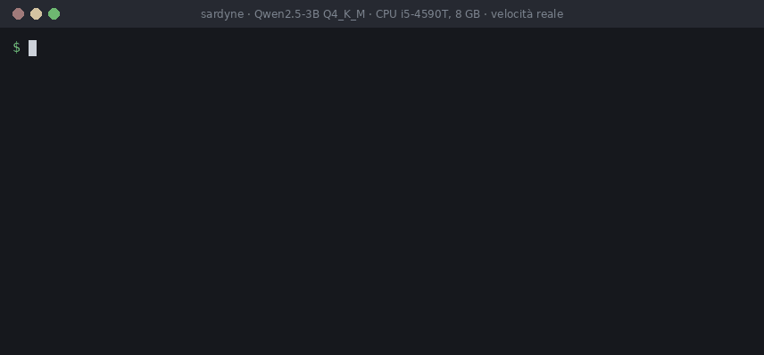

# Sardyne

Motore di inferenza per LLM open-weight, scritto da zero in **C11 e Python**, che gira solo su **CPU**.
Legge i file GGUF, offre una chat da terminale e un server compatibile con l'API OpenAI, con tool calling.

È nato come progetto di studio: capire a fondo come funziona l'inferenza, costruendo ogni parte
invece di appoggiarsi a una libreria di inferenza. Il codice C non ha dipendenze oltre alla libreria
standard e a pthreads. Ogni kernel C ha una controparte in NumPy che fa da riferimento numerico nei test.

Riesce a far girare **Qwen3-30B-A3B** (file da 18 GB) su una macchina con **8 GB di RAM**, a circa
2,5 token/s, senza caricare tutto il modello in memoria.

Il nome viene dalla Sardegna, dove il progetto è nato, e dalle sardine: i modelli stanno stipati in poca
RAM come in una scatoletta. La *dyne* finale è l'unità di forza.



*Sessione registrata con Qwen2.5-3B Q4_K_M su un i5-4590T con 8 GB di RAM, alla velocità reale.*

## Funzionalità

- **Formato GGUF:** parser proprio con accesso ai pesi tramite `mmap`.
- **Pesi:** F32, F16, BF16, Q8_0, Q4_0, Q5_0, Q4_K, Q6_K.
- **Architetture:** `llama`, `qwen2`, `qwen3` e `qwen3moe` (Mixture of Experts).
- **Kernel:** AVX2/FMA/F16C scelti all'avvio in base alla CPU, con fallback scalare portabile.
- **Modelli più grandi della RAM:** per i MoE vengono letti solo gli esperti scelti dal router, con
  prefetch asincrono dei pesi.
- **Tokenizer BPE proprio:** letto dai metadati del GGUF, senza librerie esterne.
- **Sampling:** temperature, top-k, top-p, min-p, repetition penalty e seed, nell'ordine di llama.cpp.
- **Chat:** template Jinja del modello eseguito in sandbox e prompt caching tra un turno e l'altro.
- **Server FastAPI:** `/v1/chat/completions` con streaming SSE, tool calling e `tool_choice`.
- **Protezione dei turni:** un token speciale scritto da un utente o da uno strumento resta testo normale.
- **Conversione:** da safetensors Hugging Face a GGUF, con quantizzazione Q8_0 e Q4_0.

## Requisiti

- Linux x86-64 con `gcc` e `make`
- Python 3.10 o successivo
- Una CPU con AVX2 per avere buone prestazioni (senza, si usano i kernel scalari, molto più lenti)

Il `Makefile` prevede anche macOS, ma questa configurazione non è stata provata. I kernel NEON per
Apple Silicon non esistono ancora, quindi lì si userebbero quelli scalari.

## Installazione

```bash
git clone https://github.com/ghostmars919/sardyne.git
cd sardyne

python3 -m venv .venv
source .venv/bin/activate
pip install -e '.[dev,server]'

make
```

`make` produce `build/libsardyne.so`. L'installazione con `-e` è necessaria perché il pacchetto Python
cerca la libreria nella cartella `build/` del repository. In alternativa si può indicarne il percorso
con la variabile d'ambiente `SARDYNE_LIB`.

La build usa `-march=native`, quindi è ottimizzata per la macchina su cui si compila. Per una build
portabile c'è `make ARCHFLAGS=`: i kernel AVX2 restano inclusi e vengono attivati solo se la CPU li
supporta.

## Scaricare un modello

`scripts/download_model.py` accetta `repository:file` e salva il file in `models/gguf/`.

```bash
# piccolo, per una prima prova
python scripts/download_model.py bartowski/SmolLM2-135M-Instruct-GGUF:SmolLM2-135M-Instruct-Q4_K_M.gguf

# buon compromesso, consigliato per chat e strumenti
python scripts/download_model.py Qwen/Qwen2.5-3B-Instruct-GGUF:qwen2.5-3b-instruct-q4_k_m.gguf
```

I GGUF devono contenere il tokenizer. Sono supportati i tipi BPE `qwen2` e `smollm`
(chiave `tokenizer.ggml.pre`); un GGUF con un altro tipo viene rifiutato con un errore esplicito.

## Uso

### Chat da terminale

```bash
python -m sardyne.cli models/gguf/qwen2.5-3b-instruct-q4_k_m.gguf
```

Dentro la chat, `/reset` ricomincia la conversazione ed `/exit` esce.

| Opzione | Significato | Default |
|---|---|---|
| `--system TESTO` | Messaggio di sistema | quello del template |
| `--max-seq N` | Lunghezza del contesto | 4096 |
| `--max-tokens N` | Token massimi per risposta | 1024 |
| `--threads N` | Thread di calcolo | uno per core |
| `--no-think` | Chiede al modello di non ragionare (Qwen3) | |
| `--hide-think` | Non mostra il blocco `<think>` | |

### Sampling

Le stesse opzioni valgono per CLI, server e `sardyne.runtime`. Il default è il greedy, deterministico.

| Opzione | Significato | Default |
|---|---|---|
| `--temperature T` | 0 = greedy | 0 |
| `--top-k K` | 0 = disattivato | 0 |
| `--top-p P` | Nucleus sampling | 1.0 |
| `--min-p P` | Probabilità minima relativa al token migliore | 0.0 |
| `--repeat-penalty R` | 1.0 = disattivata | 1.0 |
| `--repeat-last-n N` | Token recenti considerati dalla penalty | 64 |
| `--seed S` | Ripete la stessa sequenza | |

### Generazione singola

```bash
python -m sardyne.runtime models/gguf/SmolLM2-135M-Instruct-Q4_K_M.gguf "The capital of France is" -n 20
```

`--compare` confronta i logits del runtime C con la reference NumPy, `--no-simd` forza i kernel scalari.

### Server compatibile OpenAI

```bash
python -m sardyne.server models/gguf/qwen2.5-3b-instruct-q4_k_m.gguf --port 8080
```

Il server ascolta solo su `127.0.0.1`. Per esporlo in rete si usa `--host` con una chiave nella variabile
`SARDYNE_API_KEY`: vedi [Sicurezza](#sicurezza).

| Endpoint | Descrizione |
|---|---|
| `POST /v1/chat/completions` | Chat, con e senza streaming |
| `GET /v1/models` | Modello caricato |
| `GET /health` | Stato del server |

Con il client ufficiale:

```python
from openai import OpenAI

client = OpenAI(base_url="http://127.0.0.1:8080/v1", api_key="nessuna")
stream = client.chat.completions.create(
    model="local",
    messages=[{"role": "user", "content": "Dimmi la capitale d'Italia."}],
    stream=True,
)
for chunk in stream:
    if chunk.choices and chunk.choices[0].delta.content:
        print(chunk.choices[0].delta.content, end="", flush=True)
```

Oltre ai parametri standard (`max_tokens`, `stop`, `temperature`, `top_p`, `seed`, `tools`,
`tool_choice`) sono accettati `top_k`, `min_p`, `repeat_penalty` ed `enable_thinking`.

### Tool calling

```bash
curl http://127.0.0.1:8080/v1/chat/completions \
  -H 'Content-Type: application/json' \
  -d '{
    "model": "local",
    "messages": [{"role": "user", "content": "Che tempo fa a Roma?"}],
    "tools": [{
      "type": "function",
      "function": {
        "name": "meteo",
        "description": "Meteo di una città",
        "parameters": {
          "type": "object",
          "properties": {"citta": {"type": "string"}},
          "required": ["citta"]
        }
      }
    }]
  }'
```

La risposta contiene la chiamata con `finish_reason` uguale a `tool_calls`:

```json
{
  "role": "assistant",
  "content": null,
  "tool_calls": [{
    "id": "call_1c010cc389a04c1a80c304e7",
    "type": "function",
    "function": {"name": "meteo", "arguments": "{\"citta\": \"Roma\"}"}
  }]
}
```

Il client esegue lo strumento e rimanda il risultato con un messaggio `role: "tool"`, come con l'API
OpenAI. Il modello deve avere nel template il supporto agli strumenti, come Qwen2.5 e Qwen3.

### Convertire un modello Hugging Face

Sono supportati `LlamaForCausalLM`, `Qwen2ForCausalLM` e `Qwen3ForCausalLM`. I modelli MoE non si
convertono: si usa il GGUF pubblicato.

```bash
python scripts/download_model.py HuggingFaceTB/SmolLM2-135M-Instruct
python -m sardyne.loader.convert models/SmolLM2-135M-Instruct models/gguf/smollm-q8_0.gguf --outtype q8_0
```

Valori di `--outtype`: `bf16`, `f16`, `f32`, `q4_0`, `q8_0`.

## Prestazioni

Misure su un **Intel i5-4590T** (Haswell, 4 core a 2,0 GHz, 8 GB DDR3, banda di memoria 22,3 GB/s), con
4 thread e AVX2. Sono misure di una singola macchina, utili come ordine di grandezza.

| Modello | Formato | File | Prefill (token/s) | Decode (token/s) |
|---|---|---|---:|---:|
| SmolLM2-135M | Q4_K_M | 101 MB | 383 | 132,6 |
| Qwen2.5-0.5B | Q4_K_M | 469 MB | 127 | 41,3 |
| Qwen3-0.6B | BF16 | 1,2 GB | 107 | 15,7 |
| Qwen2.5-3B | Q4_K_M | 2,0 GB | 20,1 | 8,9 |
| Qwen2.5-7B | Q4_K_M | 4,4 GB | 8,9 | 4,1 |
| Qwen3-30B-A3B | Q4_K_M | 18 GB | 1,1-1,6 | ~2,5 |

Il dato del 30B è misurato con il modello già nella page cache. A freddo il decode scende a circa
0,6 token/s. Un primo turno di chat da 28 token ha richiesto
circa 30 secondi, quindi questo modello è utilizzabile ma non è interattivo su una macchina simile.

## Architettura

```text
Python  sardyne/server.py   API OpenAI (FastAPI)
        sardyne/cli.py      chat da terminale
        sardyne/chat.py     template, tool calling, prompt caching
        sardyne/sampling.py  sardyne/tokenizer/bpe.py
        sardyne/runtime.py   sardyne/capi.py (ctypes)
           |
C       csrc/model_llama.c  forward, KV cache, Mixture of Experts, prefetch
        csrc/quant*.c       pesi quantizzati
        csrc/ops*.c         kernel scalari e AVX2
        csrc/gguf.c         parser e mmap
        csrc/threadpool.c   thread pool
```

| Cartella | Contenuto |
|---|---|
| `csrc/` | Runtime C e API pubblica in `engine.h` |
| `sardyne/` | Pacchetto Python |
| `sardyne/ref/` | Reference NumPy, usata come oracolo nei test |
| `sardyne/loader/` | Lettura di GGUF e safetensors, scrittura di GGUF, conversione |
| `tests/` | Test `pytest` |
| `bench/` | Velocità di decode e perplexity |
| `scripts/` | Download di modelli e dataset |
| `tools/` | `gguf-info` per ispezionare un GGUF, `membw` per misurare la banda di memoria |

## Test

```bash
make test        # test Python con la build normale
make test-asan   # ASan e UBSan su parser, runtime e quantizzazione
make test-tsan   # ThreadSanitizer sui test multithread (lento)
```

I test dipendono in parte dai modelli presenti in `models/`: quelli che non trovano un file vengono
saltati. Su un clone senza modelli passano 620 test e 343 vengono saltati, in meno di un minuto. Con
tutti i modelli scaricati la suite completa è di 981 test e richiede circa 7 minuti.

Le verifiche principali sono:

- **Numeriche:** i logits del runtime C vengono confrontati con la reference NumPy.
- **Tokenizer:** gli ID vengono confrontati con la libreria `tokenizers` su ogni carattere del piano
  multilingue di base e sul testo di wikitext-2.
- **Sampling:** ogni filtro è provato su distribuzioni scritte a mano.
- **Server:** i test usano prima un motore finto, poi il client `openai` su un server vero.

Per confrontare la reference con Hugging Face servono inoltre `torch` e `transformers`
(`pip install -e '.[ref]'`). Per la perplexity si scarica prima il dataset:

```bash
python scripts/download_wikitext.py
python bench/perplexity.py models/gguf/qwen2.5-3b-instruct-q4_k_m.gguf
```

## Limiti noti

- Il server gestisce **una richiesta alla volta**: le altre aspettano, e una conversazione diversa svuota
  la cache del prompt.
- Con `tool_choice` obbligatorio la chiamata è forzata, ma **gli argomenti non sono vincolati allo
  schema**: il client deve validarli.
- Non sono supportati immagini, `n > 1` e logprobs.
- I kernel sono solo CPU: niente GPU e niente NEON per ora.
- Il prefill dei modelli grandi è lento: con prompt lunghi l'attesa dipende soprattutto da questa fase.
- Con i modelli più grandi della RAM la velocità dipende dal disco. Il prefetch non è stato misurato su
  macchine con più di 8 GB.
- I GGUF creati con vecchie versioni di `sardyne.loader.convert` non contengono il tokenizer e vanno
  riconvertiti.

## Sicurezza

- **Chiave API:** meglio impostarla con `SARDYNE_API_KEY`. L'opzione `--api-key` funziona, ma la chiave resta
  visibile in `ps` e nella cronologia della shell.
- **Rete:** il server non gestisce TLS, quindi chiave e conversazioni viaggiano in chiaro. Fuori da `127.0.0.1`
  serve un reverse proxy HTTPS o un tunnel.
- **File GGUF:** conviene usare solo modelli di fonti fidate. Il parser è provato su file malformati e il template
  gira in sandbox, ma il codice non è stato sottoposto a fuzzing né a una revisione di sicurezza esterna.

## Riconoscimenti

[llama.cpp](https://github.com/ggml-org/llama.cpp) è stato il riferimento per il formato GGUF, i formati
di quantizzazione e l'ordine dei filtri di sampling. Alcune funzioni brevi di quantizzazione
sono adattate da ggml: sono elencate, con la licenza MIT originale, in
[THIRD_PARTY_LICENSES](THIRD_PARTY_LICENSES).

## Licenza

Copyright (c) 2026 ghostmars919.

Sardyne è distribuito sotto la licenza [GPL-3.0](LICENSE). I modelli non fanno parte di questo repository
e hanno le proprie licenze. Le parti derivate da progetti di terzi sono indicate in
[THIRD_PARTY_LICENSES](THIRD_PARTY_LICENSES).
